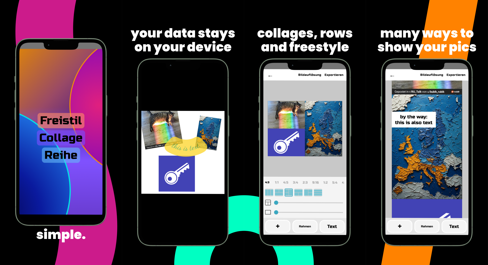
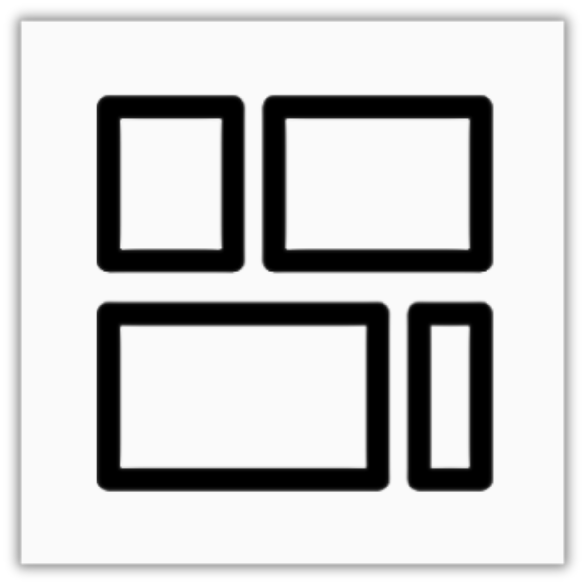

  

<h2 align="center">Collage — unleash your artist!</h2>

  

<h3 align="center">"the only one I know"</h3>

### Core Functions
* **freestyle**
* **collages**
* **pic rows**

### Features
* texts
* pic-rows
* more is coming in frightening version 3.0 ...

---
### Languages 🌎
* 100+ fully available, including:
* English 🇺🇸
* Spanish 🇪🇦
* French 🇨🇵
* Hindi 🇮🇳
* ...
---

### ❤️ Donations
*Stripe Link:* [much thanks](https://donate.stripe.com/eVq3cv8XAbah7W3gSm8bS00)

### 👨‍⚖️ Legal Stuff
Copyright © 2026 F. H. (richyrichs-daylab). All Rights Reserved.
This repository is public for preview and showcase purposes only. Unauthorized copying, redistribution, or commercial use is strictly prohibited.
